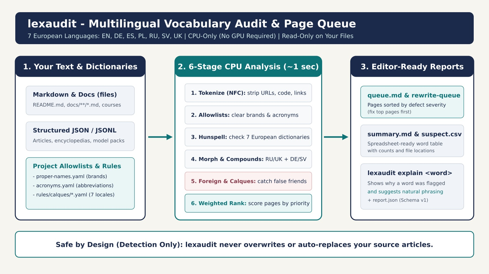
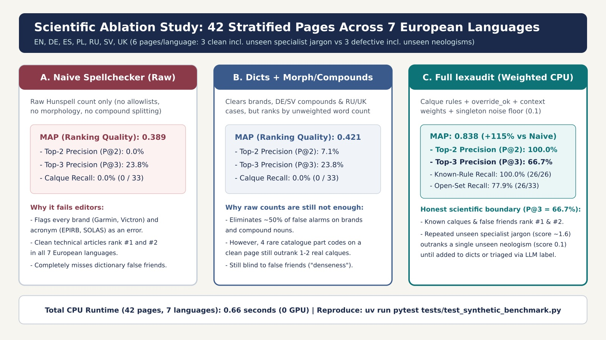
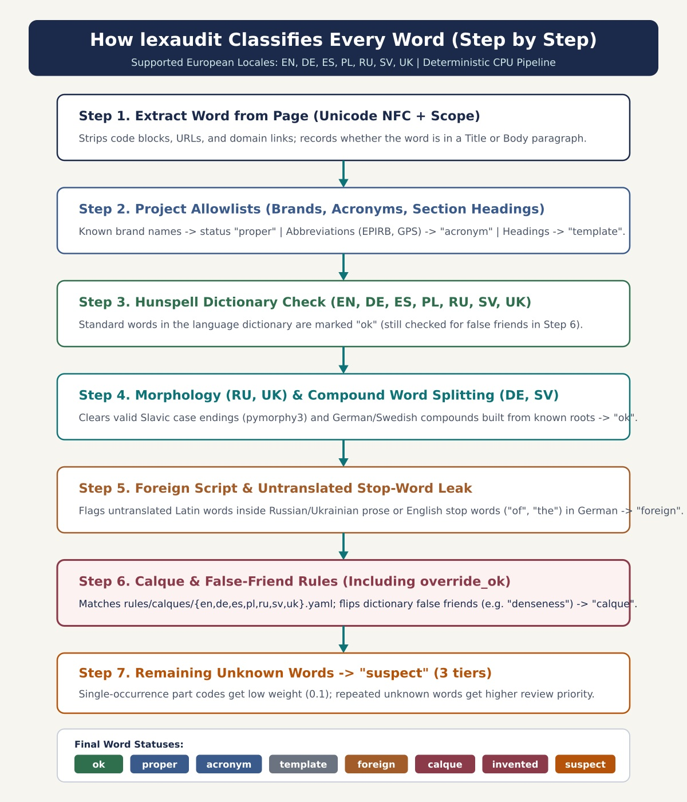

# lexaudit

**Finds odd, wrong or copied-from-another-language words in your texts, and tells you which pages to fix first.**

## In plain words

You write or translate articles, courses or documentation. A normal spellchecker shouts about every brand name, abbreviation and long German word, and still misses the words that really hurt: a word copied from another language ("calque"), a real word used with the wrong meaning ("false friend"), or a word someone invented.

lexaudit reads your files, ignores the harmless things, and gives you a short ranked list: "look at this page first." It runs on an ordinary laptop in about a second. No graphics card, no internet, no account.

It only reports. It never changes your texts.

Unknown terms? See the [glossary](docs/glossary.md).

- Languages: English (`en`), German (`de`), Spanish (`es`), Polish (`pl`), Russian (`ru`), Swedish (`sv`), Ukrainian (`uk`)
- Hardware: CPU only
- Author: Vadim Nareyko ([github.com/nareyko](https://github.com/nareyko))
- License (**lexaudit only**): **dual** — [MIT](LICENSE) package · [AGPL-3.0-or-later](LICENSE-AGPL-HOSTED.md) hosted SaaS ([details](docs/licensing.md)). FairHelm remains proprietary.



---

## Try it in 30 seconds

```bash
pipx run lexaudit audit --path . --locale en --check
# or: uvx lexaudit audit --path . --locale en --check
```

Missing spelling dictionaries download automatically into your user cache. No GPU. No config file required. Exit code `1` means confirmed calques or invented words remain.

Optional helpers: `lexaudit doctor`, `lexaudit fetch-dicts`, `lexaudit init`.

### Check a file or a whole project

```bash
# One file or folder, no settings file needed
uv run lexaudit audit --path ./README.md --locale en

# Or create starter settings first, then check everything
uv run lexaudit init
uv run lexaudit audit --locale en
```

### Open the report

The reports are in the output folder, one subfolder per language. Start with `queue.md`:

```markdown
| score | unique_suspects | path | top_words |
|---|---|---|---|
| 12.0 | 2 | docs/en/en-04-defect-known-calques.md | orientir surveyness |
| 6.0 | 1 | docs/en/en-05-defect-false-friend.md | denseness |
| 1.6 | 2 | docs/en/en-03-clean-unseen-jargon.md | vinylester haulout |
```

A higher score means "look here first". `top_words` shows the words behind the score.

### Ask why a word was flagged

```bash
uv run lexaudit explain orientir --locale en
```

```text
word: orientir (normalized: orientir, locale: en)
status: calque (tier: confirmed)
reason: loan-calque-orientir | detectors: calque, hunspell
editorial hint: working rule / ballpark / figures - not orientir
```

### Reproduce our test results

```bash
uv run lexaudit audit --config examples/synthetic-demo/lexaudit.config.yaml
```

Then open `tmp/synthetic-demo-out/<language>/queue.md`.

---

## How good is it? An honest answer

We built a 42-page test set in all 7 languages: 21 clean technical pages and 21 pages with planted problems. Some problems are known to the rules, some are brand new words the rules have never seen. Details: [docs/synthetic-benchmark.md](docs/synthetic-benchmark.md).



| Setup | Bad page in top 2 | Bad page in top 3 | MAP (0 to 1, higher is better) | Known problems found | Brand new problems found | Time |
|---|---:|---:|---:|---:|---:|---:|
| A. Plain spellchecker | 0.0% | 23.8% | 0.389 | 0 of 26 | 0 of 33 | 0.54 s |
| B. Plus your word lists | 7.1% | 23.8% | 0.421 | 0 of 26 | 0 of 33 | 0.62 s |
| C. Full lexaudit | 100.0% | 66.7% | 0.838 | 26 of 26 | 26 of 33 | 0.66 s |

What this means:

- Pages with known problems come first in every language. The plain spellchecker puts clean pages first.
- About 78% of all planted problems are found, including words the rules never saw. About 22% are missed.
- Weak spot: a clean page with a repeated new technical term can outrank a page with a single new invented word. Adding the term to your word list, or using the optional `label` step, fixes this.

---

## Documentation

Start with [`docs/README.md`](docs/README.md).

| Guide | What you learn |
|---|---|
| [Glossary](docs/glossary.md) | Every term in plain words |
| [Benchmark](docs/synthetic-benchmark.md) | The 42-page test, step by step |
| [Architecture](docs/architecture.md) | What goes in, what comes out |
| [Pipeline](docs/pipeline.md) | The gates every word passes |
| [CLI reference](docs/cli-reference.md) | All commands |
| [Agent workflow](docs/agent-workflow.md) | From report to fixed page |
| [Scores and metrics](docs/weights-and-metrics.md) | How pages are scored |



---

## More commands

```bash
# Re-rank pages, filter by source (docs, academy, model_pack)
uv run lexaudit rank --locale ru --mode weighted --sources=docs

# Add every page that contains a known bad word to your to-do list
uv run lexaudit expand-needle --needle orientir --locale all \
  --write-queue /abs/path/to/rewrite-queue.md

# Optional: ask a language model for a second opinion (your own endpoint)
uv run lexaudit label --locale ru --top-pages 20 --top-words 50 --tiers likely,weak --profile cpu

# Compare two runs
uv run lexaudit diff --baseline .../report.json --current .../report.json --out /tmp/diff.json
```

---

## For contributors

Setup and checks:

```bash
uv sync --extra dev
uv run ruff check . && uv run ruff format --check .
uv run mypy --strict src/
uv run pytest
uv run python scripts/crap_report.py
uv run mutmut run && uv run python scripts/check_mutation_score.py --min-percent 80
uv build
```

Test layers: unit and integration tests (branch coverage 80% or more), the 7-language benchmark, property-based fuzzing (Hypothesis), golden regression with a read-only check of your files, JSON Schema contract, complexity gate (CRAP), mutation testing (kill rate 80% or more).

Pictures in `docs/images` are generated from code: run `python scripts/render_diagrams.py` (needs Inkscape and Pillow). Never edit the JPG files by hand.

## License (dual — lexaudit only)

Applies to **this package**, not to FairHelm (FairHelm is proprietary).

| How you use **lexaudit** | License |
|---|---|
| CLI, library, YAML rules, packs (local, CI, embed) | **[MIT](LICENSE)** |
| Hosted multi-tenant SaaS over the network to third parties | **[AGPL-3.0-or-later](LICENSE-AGPL-HOSTED.md)** |

Full wording: [docs/licensing.md](docs/licensing.md). Dictionaries from `fetch-dicts` keep their upstream licenses.

## Origin and author

Created and maintained by Vadim Nareyko ([github.com/nareyko](https://github.com/nareyko)). It grew out of auditing multilingual courses and encyclopedias at [FairHelm](https://fairhelm.com).
