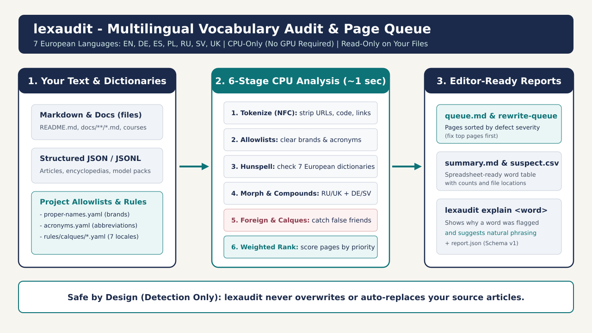
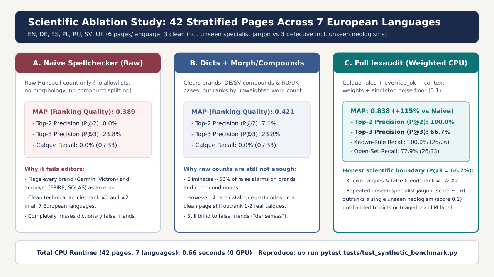
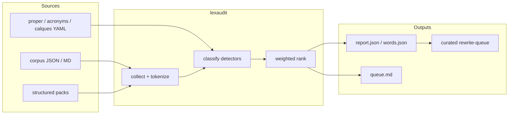

# lexaudit documentation

**In plain words:** lexaudit reads your texts in 7 languages and tells you which pages have odd, wrong or copied-from-another-language words. You read the short report and fix the pages yourself. New to the terms? See the [glossary](glossary.md).

**Technically:** lexaudit inventories long-form vocabulary across 7 European languages (`en`, `de`, `es`, `pl`, `ru`, `sv`, `uk`): it catches translation calques, dictionary false friends, invented words, untranslated foreign tokens, and morphological misses, then ranks pages so editors know which file to review first.

**For non-technical users & editors (no GPU required):** `lexaudit` runs on any laptop CPU in under a second. It never modifies your articles or translations; it only produces readable reports (`queue.md`, `summary.md`) and explains flagged words (`lexaudit explain`).

- Author: Vadim Nareyko ([github.com/nareyko](https://github.com/nareyko))
- Origin: Extracted from multilingual courses and engineering encyclopedias at [FairHelm](https://fairhelm.com)
- License: dual MIT package / AGPL-3.0-or-later hosted SaaS ([licensing.md](licensing.md))



## Contents

| Doc | What |
|---|---|
| [7-Locale Benchmark](synthetic-benchmark.md) | Stratified 42-page ablation study across EN, DE, ES, PL, RU, SV, UK (`MAP 0.838`) |
| [Glossary](glossary.md) | Every term in plain words |
| [Architecture](architecture.md) | What goes in, what comes out, package layout |
| [Pipeline](pipeline.md) | The gates every word passes, statuses, calque rules |
| [CLI reference](cli-reference.md) | `init`, `doctor`, `audit`, `explain`, `rank`, `expand-needle`, `label`, `eval`, `diff` |
| [Licensing](licensing.md) | Dual license: MIT package, AGPL for hosted SaaS |
| [DE UI loans](p1-de-loan-policy.md) | German keeps Dashboard/Toast on purpose (extras only, not DEFAULT) |
| [0.3.0 prep](p1-0.3.0-prep.md) | Ten RC packs in `packs/`; bilingual stays opt-in |
| [Next-wave plan](p1-next-wave-plan-2026-10-30.md) | Wild wiki corpus, bilingual/crosslocale fixes, product shell |
| [Next-wave status](p1-status-next-wave-2026-10-30.md) | What is thin now and how to fix it |
| [Product shell checklist](p1-product-shell-checklist-2026-10-30.md) | VS Marketplace + MCP registry owner steps |
| [Agent workflow](agent-workflow.md) | From report to fixed page and back |
| [Scores and metrics](weights-and-metrics.md) | How pages are scored, how quality is measured |

Also see root [`README.md`](../README.md), [`examples/lexaudit.config.example.yaml`](../examples/lexaudit.config.example.yaml), [`examples/lexaudit.config.bilingual.yaml`](../examples/lexaudit.config.bilingual.yaml), and [`examples/synthetic-demo/lexaudit.config.yaml`](../examples/synthetic-demo/lexaudit.config.yaml).

## 7-Language European Ablation Summary



On the stratified 42-page benchmark (`en`, `de`, `es`, `pl`, `ru`, `sv`, `uk`), a naive spellchecker ranks clean technical pages ahead of defective ones (`MAP = 0.389`, `Precision@2 = 0.0%`). Full `lexaudit` raises `MAP` to 0.838 (`Precision@2 = 100.0%`, `Precision@3 = 66.7%`, `Known-Rule Recall = 100.0%`, `Open-Set Recall = 77.9%` in ~0.66 seconds on CPU). See [7-Locale Benchmark](synthetic-benchmark.md) for the full error analysis.

## Auditing Markdown documentation out of the box (no GPU required)

With `lexaudit init`, `lexaudit audit --path`, or zero-config `lexaudit audit`, `lexaudit` automatically collects root Markdown files (`README.md`, `CONTRIBUTING.md`, `SECURITY.md`, `CHANGELOG.md`) and `docs/**/*.md` (or `docs/<locale>/**/*.md`), splitting each document into `title` (first H1) and `body` scopes.

```bash
uv run lexaudit doctor
uv run lexaudit audit --path ./README.md --locale en
uv run lexaudit explain orientir --locale en
```

## Pictures

SVG only in git (~1 MiB of raster JPG duplicates removed). Optional local JPGs via
`uv run python scripts/render_diagrams.py --jpg` (gitignored).

| Image | Description |
|---|---|
| [overview.svg](images/overview.svg) | Corpus → pipeline → reports |
| [synthetic-benchmark.svg](images/synthetic-benchmark.svg) | 7-locale ablation study |
| [classify-pipeline.svg](images/classify-pipeline.svg) | Word classification ladder |
| [host-bridge.svg](images/host-bridge.svg) | Host dictionaries + editorial rewrite loop |
| [pipeline-flow.svg](images/pipeline-flow.svg) | Alias of overview (kept for old links) |

## One-screen mental model



## Hard rules

1. No auto-replace in prose sources.
2. Curated queue over raw counts: editors and agents work from weighted and needle queues, not raw `unique_suspects`.
3. Calque needles (`orientir`, `denseness`, ...) override dictionary `ok` when `override_ok: true`.
4. Soft CI / `eval regression` stay non-blocking; opt-in `audit --check` may fail
   on confirmed calque/invented when a host enables it.
5. Host dictionaries stay outside `lexaudit` and are loaded via configuration paths.
