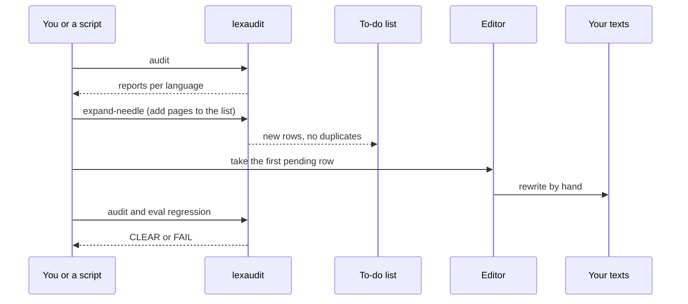

# From report to fixed page


## In plain words

lexaudit finds. People (or an editing assistant you control) fix. Then lexaudit measures again to confirm the problem is gone. The tool never rewrites your texts.

## Why not just read the raw list?

A plain list of unknown words is mostly noise: German compounds, names, harmless foreign terms. The useful workflow ranks pages by how serious their problems are, tracks specific bad words ("needles") and keeps a short to-do list.



## To-do list format

A plain Markdown table (or the same in JSON):

```markdown
| # | status | slug / path | locales | target defects | note |
|---|---|---|---|---|---|
| 1 | pending | `systems/propeller-shaft-seals` | DE | `orientir*` | |
```

Statuses: `pending`, `in_progress`, `done`, `skipped`. Duplicates are skipped when you append.

## The loop, step by step

```bash
# 1. Full check of all seven languages
uv run lexaudit audit --config /abs/path/lexaudit.config.yaml --locale en,de,es,pl,ru,sv,uk

# 2. Add pages with a known bad word to the to-do list
uv run lexaudit expand-needle \
  --config /abs/path/lexaudit.config.yaml \
  --needle orientir --locale all \
  --write-queue /abs/path/rewrite-queue.md

# 3. A person rewrites the first pending page (lexaudit stops here)

# 4. Measure again and check the fix
uv run lexaudit audit --config /abs/path/lexaudit.config.yaml --locale en,de,es,pl,ru,sv,uk
uv run lexaudit eval regression --config /abs/path/lexaudit.config.yaml
uv run lexaudit eval product --config /abs/path/lexaudit.config.yaml
```

## Optional: a language model as a second opinion

If you run your own OpenAI-compatible endpoint, `lexaudit label` asks it to class and comment the top weak or likely words:

```bash
uv run lexaudit label --config /abs/path/lexaudit.config.yaml \
  --locale de --top-pages 15 --top-words 40 --profile gpu
```

This step is optional and off by default. Answers are hints for a human. The tool never edits files.
