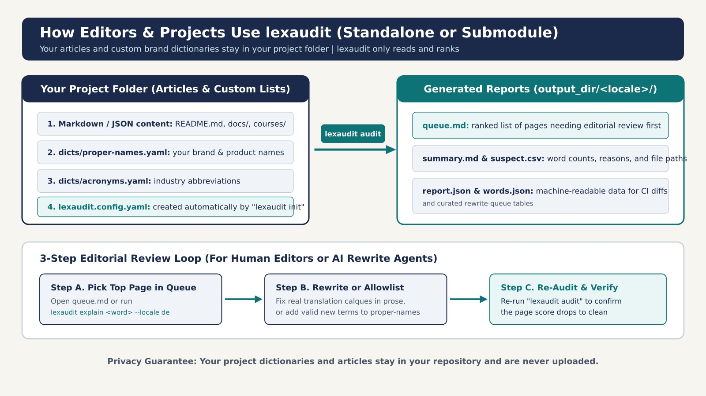
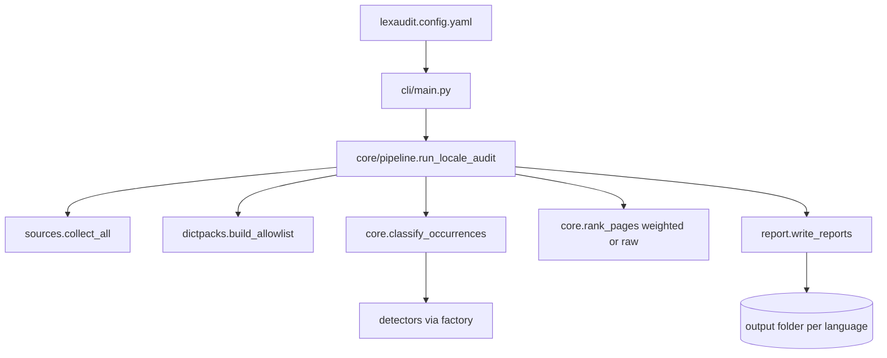

# How lexaudit is built



## In plain words

lexaudit reads your texts, checks every word, and writes a short report that says which pages to look at first. You give it two things: your texts and a small settings file. It gives back readable files. It never changes your texts.

Everything runs on an ordinary computer processor. No graphics card, no internet and no account is needed.

## What you provide and what you get

| You provide | What it is |
|---|---|
| Your texts | Markdown files, a `docs/` folder, or exported JSON |
| `lexaudit.config.yaml` | Settings: which folders, which languages. `lexaudit init` writes it for you |
| Your word lists (optional) | Names and abbreviations that are fine (`dicts/*.yaml`) |

| You get | What it is |
|---|---|
| `queue.md` | The pages to review first, best place to start |
| `summary.md` | A one-page overview per language |
| `suspect.csv`, `pages.csv` | The same data for a spreadsheet |
| `report.json`, `words.json` | The same data for scripts |

## Where things live

| Location | Role |
|---|---|
| `github.com/nareyko/lexaudit` | The package itself (MIT, by Vadim Nareyko) |
| Your project, `lexaudit.config.yaml` | Your settings |
| Your project, `dicts/*.yaml` | Your own names, abbreviations, allowed words |
| Your project, output folder | Generated reports. Safe to delete and regenerate |
| `rewrite-queue.md` (optional) | A hand-curated to-do list for editors |

## For developers: package layout

```text
lexaudit/
  src/lexaudit/
    cli/main.py          # init | doctor | audit | pack | explain | rank | …
    config.py            # YAML to LexauditConfig (enable_bilingual default false)
    core/                # tokenize, classify, rank, pipeline
    detectors/           # allowlist, hunspell, morph, compound, foreign,
                         # english_leak, calque, bilingual (opt-in)
    packs.py             # pack list/install/verify (packs/ + packs/_lab --lab)
    dictpacks/loader.py  # names, abbreviations, known compound parts
    sources/collect.py   # Markdown, academy JSON, packs, HTML/PO/XLIFF, …
    report/              # write, diff, expand_needle, CI/SARIF
    curated/queue.py     # rewrite-queue.md or JSON
    llm/                 # optional label step, cached on disk
    eval/                # quality metrics
  packs/core-calques-v1/ # release pack
  packs/_lab/            # experimental domain packs (0.3.0 owner go)
  rules/calques/         # FairHelm bridge copy of core calques
  schema/report-v1.schema.json
  scripts/render_diagrams.py
  scripts/fairhelm_soft_dogfood.sh
  docs/
```



## Settings reference

| Key | Meaning |
|---|---|
| `sources` | Where to read texts: `files`, `academy`, `packs`, `md`, `jsonl_export` |
| `files_paths` | Markdown files or folders. Default: root `*.md` plus `docs/` |
| `academy_root`, `packs_root` | Structured text folders |
| `proper_names_path`, `acronyms_path`, `allowlist_path` | Your word lists |
| `calque_rules_dir` | Folder with calque rules. Default is the bundled `rules/calques` |
| `rank_mode` | `weighted` (default) or `raw` |
| `needles` | Words you want found everywhere |
| `gold_slugs`, `regression_needles` | Pages and words for the quality checks |
| `rank_weights` | How serious each kind of problem is |
| `enable_llm` | Off by default. The optional label step needs your own endpoint |
| `enable_bilingual` | Off by default. Opt-in EN↔locale leftover pass |
| `bilingual_pairs` | List of `{source_locale, target_locale, source_root, target_root}` |
| `bilingual_extra_loans_path` | One-token-per-line extras (e.g. DE UI nouns). Not package DEFAULT |
| `bilingual_extra_loans_locales` | Locales that may merge those extras (use `[de]` for DE UI loans) |

DE UI loans (`dashboard`, `toast`, …): see [p1-de-loan-policy.md](p1-de-loan-policy.md)
and `examples/dicts/intentional-extra-de.txt`.

## Reproducible pictures

The diagrams in `docs/images` are drawn from code, not by hand or by an image generator. Run `python scripts/render_diagrams.py` to rebuild them. It writes the SVG files, then converts them to JPG with Inkscape and Pillow. The same script always gives the same pictures.

## Reproducible reports

The same texts and settings give identical CSV and Markdown. In JSON, `--freeze-at` fixes the timestamp so tests can compare files byte by byte.

## What lexaudit is not

- Not a grammar checker like LanguageTool
- Not a checker for translation keys or placeholders
- Not an automatic translator or rewriter
- Not a gate that fails your build when it finds suspects (it is a soft report)
