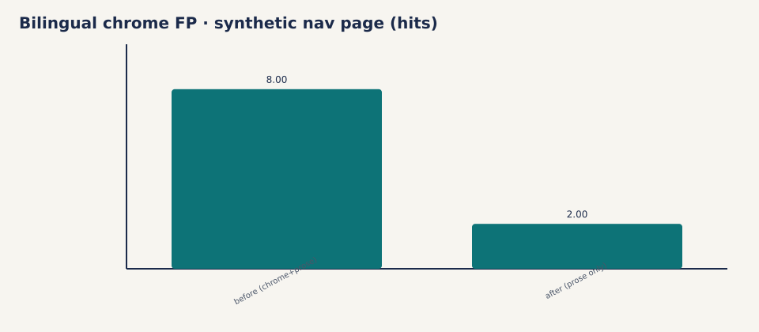

# Bilingual chrome FP hygiene · 2026-10-30

## Problem

Opt-in bilingual leftover detection flags shared Latin tokens. On CMS-shaped
trees (academy/wiki shells) that produced thousands of hits on brand/nav crumbs
(`definition`, `related`, `limits`, `academy`, `fairhelm`, …) that are not
untranslated prose.

## Change

`DEFAULT_TEMPLATE_CHROME` in `detectors/bilingual.py` skips those shells.
Real UI leftovers (`sidebar`, `toast`, `dashboard`, `inbox`, …) stay detectable
and still belong in corpus extras / gold — not in this set.
Kebab slug skip (`count("-") >= 2`) unchanged.

## Checks

| Check | Result |
|---|---|
| Unit: chrome skipped, prose leftover kept | `test_template_chrome_skipped_but_prose_leftover_kept` |
| Held-out / live fixtures still see `sidebar` / `toast` | pytest bilingual suite |
| Package default | `enable_bilingual: false` unchanged |

## Cyrillic→Latin

Live Cyrillic→Latin harvest remains thin; held-out `untranslated_cyrillic_in_target`
coverage still applies. Expanding live harvest is a follow-up, not blocking 0.3.0.
