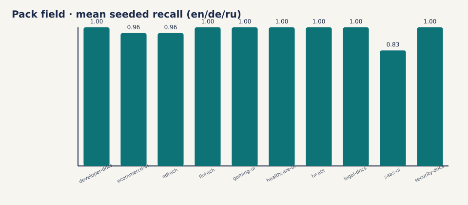

# Pack field eval · 2026-10-30

Held-out corpus: `tests/fixtures/packs_field/` (not pack `04-defect-known`).
Rows: 30. Failed gates: **0** (need seeded_recall≥0.70, clean_calque_hits=0, defect_score>clean_score).



Also see: [bilingual chrome](p1-bilingual-chrome-2026-10-30.md) ·
[crosslocale dogfood](p1-crosslocale-dogfood-2026-10-30.md) ·
[plan](p1-field-eval-plan-2026-10-30.md).

| Pack | en recall | de recall | ru recall | clean FP (sum) | rank OK |
|---|---:|---:|---:|---:|:---:|
| `saas-ui-v0` | 0.75 | 1.00 | 0.75 | 0 | yes |
| `fintech-v0` | 1.00 | 1.00 | 1.00 | 0 | yes |
| `developer-docs-v0` | 1.00 | 1.00 | 1.00 | 0 | yes |
| `ecommerce-ui-v0` | 0.88 | 1.00 | 1.00 | 0 | yes |
| `healthcare-ui-v0` | 1.00 | 1.00 | 1.00 | 0 | yes |
| `legal-docs-v0` | 1.00 | 1.00 | 1.00 | 0 | yes |
| `gaming-ui-v0` | 1.00 | 1.00 | 1.00 | 0 | yes |
| `edtech-v0` | 0.88 | 1.00 | 1.00 | 0 | yes |
| `security-docs-v0` | 1.00 | 1.00 | 1.00 | 0 | yes |
| `hr-ats-v0` | 1.00 | 1.00 | 1.00 | 0 | yes |

Macro mean seeded recall: **0.975**.

## Method

Each RC pack's rules audit reconstructed clean + seeded pages under `tests/fixtures/packs_field/<pack>/{en,de,ru}/`. Seeded tokens come from that pack's YAML (see `gold.csv`). This is still coinage-shaped, but the **page prose and paths are held out** from the original lab fixtures.

## Reproduce

```bash
uv run python scripts/run_pack_field_metrics.py
uv run python scripts/render_field_eval_charts.py
```
