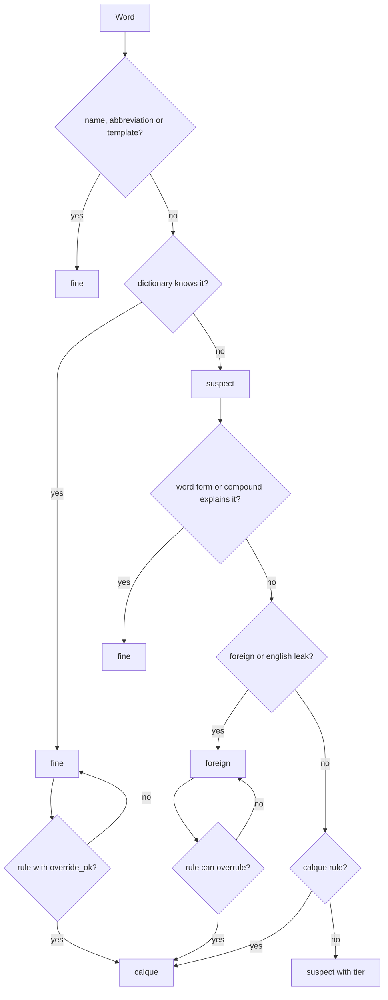

# How a word gets judged

## In plain words

Think of a security queue. Every word goes through several gates in a fixed order. A word is let through as soon as one gate says it is fine. Only words that pass every gate without being cleared end up on the report. A few special gates can also stop a word that the dictionary accepted, because it is a known trap (a false friend).

## The gates, in order

1. Read the text. The tool cuts each file into pieces: title, summary, body. Code blocks, links and web addresses are skipped.
2. Split into words. Hyphens and apostrophes inside a word stay in it.
3. Your allowlist. Names, abbreviations and section markers you declared are fine.
4. Dictionary. A word found in the language dictionary (Hunspell) is fine.
5. Word forms. Russian and Ukrainian endings are checked with `pymorphy3`. "на скеге" is a normal case form, not an error. German and Swedish long words are split into known parts.
6. Foreign words. A word in another script, or English filler words in a German page, is marked as foreign.
7. Calque rules. Lists of known bad words per language. A rule can also overrule the dictionary when the word is a false friend (`override_ok`).
8. Everything left is a suspect, in three tiers: confirmed, likely, weak.
9. Rank and write. Pages get a score and the reports are written.

## Flow diagram

## What each status means

| Status | Meaning | Counts in page score? |
|---|---|---|
| `ok` | Dictionary, word form or compound explains it | no |
| `proper`, `acronym` | On your allowlist | no |
| `template` | A fixed section marker | no |
| `foreign` | Other script, or English leak | yes, lightly |
| `calque`, `invented` | A rule matched, or a clear anomaly | yes, heavily |
| `suspect` | Unknown. Tier: confirmed, likely, weak | yes |
| `morph-miss`, `unsure` | Left over, needs a human look | yes |

## Calque rules

Files: `rules/calques/{en,de,es,pl,ru,sv,uk}.yaml`.

| Field | Meaning |
|---|---|
| `pattern` | The word, or a pattern with `*` |
| `match` | `exact`, `glob` or `prefix` |
| `severity` | `confirmed`, `likely` or `weak` |
| `override_ok` | Also flag words the dictionary accepts (false friends) |
| `hint` | A suggestion for the editor. Never applied automatically |

Safeguard: a valid case form such as Russian "на скеге" must not become a rule. Word-form checks handle those.

## Body text scopes

A Markdown file is split into `title` (first H1) and `body`. JSON sources use their own field names such as `bodyMarkdown`. Any scope starting with `body` counts as body text for the foreign-word and English-leak checks.

## Optional bilingual leftover pass

When `enable_bilingual: true`, after the monolingual gates the pipeline compares
paired EN↔target Markdown files and flags shared Latin (or Cyrillic) tokens as
`foreign` with reason `bilingual-untranslated`. Brand/protocol tokens stay in
`DEFAULT_INTENTIONAL_LOANS`. Short **German UI loans** (`dashboard`, `toast`,
`store`, `download`, `upload`, `inbox`) are **not** in that DEFAULT — merge them
only via `bilingual_extra_loans_path` + `bilingual_extra_loans_locales: [de]`.
See [p1-de-loan-policy.md](p1-de-loan-policy.md).

## Compound known parts (German, Swedish)

Before the run, the splitter learns parts from your names and abbreviations. After the first pass it also learns every dictionary-approved word from the same run, then re-checks what is left.
