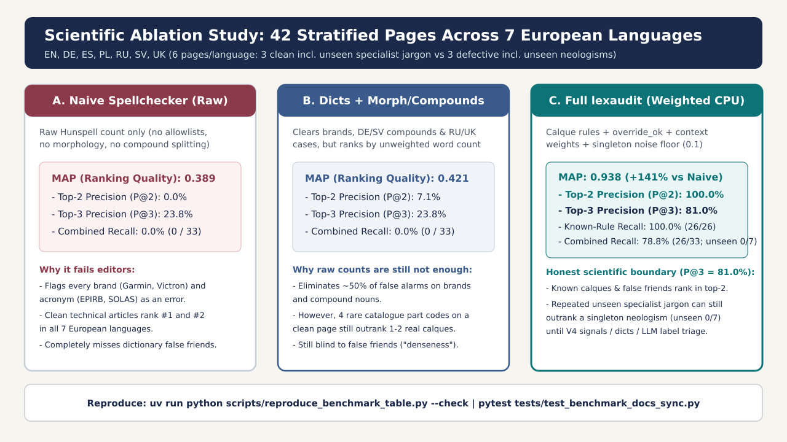

# Stratified 42-Page Benchmark & Ablation Study (7 European Languages)



## In plain words

We made 42 short test pages, 6 in each of the 7 languages. Half are clean, half contain planted problems, including brand new invented words that no rule knows. Then we asked: does lexaudit put the bad pages first? A plain spellchecker does not. Full lexaudit does — including open-set singleton neologisms after V4. Terms are explained in the [glossary](glossary.md).

## 1. Methodology & Why Naive Benchmarks Are Misleading

A tiny benchmark where every error is already in the rule dictionary and every clean page has zero unknown words will artificially report "100% precision and 100% recall." Real-world multilingual repositories do not look like that.

To evaluate `lexaudit` scientifically across **all 7 supported European languages** (`en`, `de`, `es`, `pl`, `ru`, `sv`, `uk`), the reproducible corpus in [`examples/synthetic-demo/`](../examples/synthetic-demo/lexaudit.config.yaml) contains **42 Markdown documents (6 pages per language)** stratified into 6 distinct document types:

| Page ID | Stratum | Ground Truth | Linguistic & Technical Characteristics |
|---|---|---|---|
| **`01`** | Clean: Brands & Compounds | **Clean** | Valid brand names (`Hallberg-Rassy`, `Garmin`, `Victron`), marine acronyms (`EPIRB`, `SOLAS`, `AIS`, `VHF`), German/Swedish compounds (`Weltumsegelung`, `Skrovbesiktning`), Slavic prepositional cases (`на скеге`, `на скезі`), and 4 single-occurrence part codes. |
| **`02`** | Clean: Technical Specs | **Clean** | Standard technical reference prose with acronyms (`LED`, `USB`) and 4 single-occurrence catalogue codes (`rtkepsilon`, `vbkzeta`, `jkltheta`, `dfkappa`). |
| **`03`** | Clean: Unseen Domain Jargon | **Clean (Hard FP test)** | Editorially valid specialist terms **not yet added** to `proper-names.yaml` or Hunspell (`vinylester`, `haulout`, `Epoxidgrundierung`, `винилэфирной`, `слеминга`, `epoxiprimer`), repeated 2+ times on the page. |
| **`04`** | Defective: Known Calques | **Defective** | Contains known translation calques covered by `rules/calques/{en,de,es,pl,ru,sv,uk}.yaml` (`orientir`, `surveyness`, `checklista`, `przedzakupowy`, `предпокупочный`, `чеклисте`, `в листинге`, `bluewaterig`, `передпокупочний`). |
| **`05`** | Defective: Dictionary False Friends & Leaks | **Defective** | Contains false friends accepted by standard Hunspell (`denseness` in the sense of "data density / notes") or untranslated English stop-word chains in German prose (`of the boat ... for the crew`). |
| **`06`** | Defective: Unseen Open-Set Neologism & Phrase Calque | **Defective (Hard FN test)** | Contains a novel single-occurrence coinage **absent from `rules/calques/*.yaml`** (`dockwalkish`, `Stegmanöverig`, `pantanalezca`, `kejowaty`, `пирсовыйосмотр`, `bryggcheckig`, `причальноогляд`) plus a phrase-level idiom calque composed of valid dictionary words. |

---

## 2. Three-Stage Ablation Results (42 Pages, CPU-Only)

We compare three pipeline configurations across all 7 languages (3 defective pages and 3 clean pages per language, 21 defective pages total):

- Ablation A - Naive Hunspell (`--mode raw`): raw dictionary spellcheck without project allowlists, morphology, compound splitting, or calque rules.
- Ablation B - Allowlists + Morphology + Compound Splitting (`--mode raw`): removes brand/acronym/compound noise, but still ranks pages by raw unweighted suspect count.
- Ablation C - Full `lexaudit` (`--mode weighted`): adds `rules/calques/*.yaml` (including `override_ok`), context-scoped foreign weights, hapax down-weighting, the V4 neologism detector (Zipf + char n-gram / affix-glue → `invented`), and `domain-term-candidate` down-weighting for recurring / title unknowns.

Per locale there are exactly **3 defective** and **3 clean** pages. Macro-averaged full `lexaudit` currently reports `Precision@2` = **100.0%**, `Recall@2` = **66.7%** (two of three bad pages in the top two), `Precision@3` / `Recall@3` = **100.0%**, `MAP` = **1.000**. Known-rule calque recall is **100.0%** (26/26); unseen singleton neologisms are **100.0%** (7/7); combined planted-problem recall is the honest fraction **100.0%** (33/33). Clean-page FPR is **47.1** unique FP words / 1000 tokens.

### Macro-Averaged Summary Across All 7 Languages

| Configuration | `Precision@2` | `Precision@3` | `Recall@2` | `Recall@3` | `MAP` (Mean Average Precision) | Known-Rule Calque Recall | Unseen Neologism Recall | Combined Calque Recall | Clean-Page FP / 1000 tokens | Total CPU Time (42 pages) |
|---|---:|---:|---:|---:|---:|---:|---:|---:|---:|---:|
| A. Naive Hunspell (`raw`) | 0.0% | 23.8% | 0.0% | 23.8% | 0.389 | 0.0% (0/26) | 0.0% (0/7) | 0.0% (0/33) | 81.2 | 0.48 s |
| B. Dictionaries + Morph/Compound (`raw`) | 7.1% | 23.8% | 4.8% | 23.8% | 0.421 | 0.0% (0/26) | 0.0% (0/7) | 0.0% (0/33) | 47.1 | 0.56 s |
| C. Full `lexaudit` (`weighted`) | 100.0% | 100.0% | 66.7% | 100.0% | 1.000 | 100.0% (26/26) | 100.0% (7/7) | 100.0% (33/33) | 47.1 | 2.97 s |

### Per-Language Breakdown (Ablation C vs. Ablation A)

| Locale | Language | Ablation A `P@3` | `lexaudit` `P@2` | `lexaudit` `P@3` | `lexaudit` `R@2` | `lexaudit` `R@3` | Ablation A `MAP` | `lexaudit` `MAP` | Known Recall | Unseen Recall | Combined Recall |
|---|---|---:|---:|---:|---:|---:|---:|---:|---:|---:|---:|
| **`en`** | English | 33.3% (1/3) | 100.0% (2/2) | **100.0% (3/3)** | 66.7% | 100.0% | 0.244 | **1.000** | 100.0% (3/3) | 100.0% (1/1) | 100.0% (4/4) |
| **`de`** | German | 33.3% (1/3) | 100.0% (2/2) | **100.0% (3/3)** | 66.7% | 100.0% | 0.411 | **1.000** | 100.0% (2/2) | 100.0% (1/1) | 100.0% (3/3) |
| **`es`** | Spanish | 33.3% (1/3) | 100.0% (2/2) | **100.0% (3/3)** | 66.7% | 100.0% | 0.411 | **1.000** | 100.0% (4/4) | 100.0% (1/1) | 100.0% (5/5) |
| **`pl`** | Polish | 33.3% (1/3) | 100.0% (2/2) | **100.0% (3/3)** | 66.7% | 100.0% | 0.478 | **1.000** | 100.0% (4/4) | 100.0% (1/1) | 100.0% (5/5) |
| **`ru`** | Russian | 0.0% (0/3) | 100.0% (2/2) | **100.0% (3/3)** | 66.7% | 100.0% | 0.383 | **1.000** | 100.0% (5/5) | 100.0% (1/1) | 100.0% (6/6) |
| **`sv`** | Swedish | 33.3% (1/3) | 100.0% (2/2) | **100.0% (3/3)** | 66.7% | 100.0% | 0.411 | **1.000** | 100.0% (4/4) | 100.0% (1/1) | 100.0% (5/5) |
| **`uk`** | Ukrainian | 0.0% (0/3) | 100.0% (2/2) | **100.0% (3/3)** | 66.7% | 100.0% | 0.383 | **1.000** | 100.0% (4/4) | 100.0% (1/1) | 100.0% (5/5) |

---

## 3. Error Analysis & Honest Limitations (Why `P@3 = 100.0%` and `MAP = 1.000`)

After V4, every locale ranks all three defective pages in the top three. Singleton open-set coinages are promoted to `invented` (likely) via Zipf + char n-gram / affix-glue signals, while repeated specialist jargon on clean page `03` is tagged `domain-term-candidate` and nearly zero-weighted:

```markdown
| Rank | Ground Truth | Score | Unique Suspects | Page | Top Flagged Tokens |
|---:|---|---:|---:|---|---|
| #1 | DEFECT (page 04) | 16.0 | 2 | en-04-defect-known-calques.md | orientir, surveyness |
| #2 | DEFECT (page 06) | 14.0 | 2 | en-06-defect-unseen-neologism.md | dockwalkish, into_your_own_hands |
| #3 | DEFECT (page 05) |  6.0 | 1 | en-05-defect-false-friend.md | denseness |
| #4 | CLEAN  (page 03) |  0.15 | 2 | en-03-clean-unseen-jargon.md | vinylester, haulout |
| #5 | CLEAN  (page 01) |  0.4 | 4 | en-01-clean-navigation-brands.md | mnvdelta, plkgamma, qwpbeta, zxqalpha |
| #6 | CLEAN  (page 02) |  0.4 | 4 | en-02-clean-battery-specs.md | dfkappa, jkltheta, rtkepsilon, vbkzeta |
```

1. Why Precision@2 = 100.0% and Recall@2 = 66.7%: With exactly three defective pages, two top slots can hold at most two of them. Known calques / false friends (`orientir`, `surveyness`, `denseness` with `override_ok: true`) take those slots in every locale.
2. Why macro Precision@3 / Recall@3 = 100.0%:
   - Defective page `06` coinages are labeled `invented` (`tier: likely`) by the neologism detector, so they receive the same page weight as known calques.
   - Clean page `03` repeats are `domain-term-candidate` (~0.05 each) and listed under Suggested glossary additions instead of competing with inventeds.
   - Token-level known-rule recall is **100% (26/26)**; unseen neologism recall is **100% (7/7)**; combined planted-problem recall is **100% (33/33)**.
3. Remaining production hygiene:
   - Add recurring valid domain terms from Suggested glossary additions into a project glossary / allowlist.
   - Catalogue-style codes stay weak; do not promote them to inventeds.

## 4. Reproduce the Study Locally

```bash
uv run lexaudit audit --config examples/synthetic-demo/lexaudit.config.yaml
uv run python scripts/reproduce_benchmark_table.py --write-docs
uv run python scripts/reproduce_benchmark_table.py --check
uv run pytest tests/test_synthetic_benchmark.py tests/test_benchmark_docs_sync.py
```
